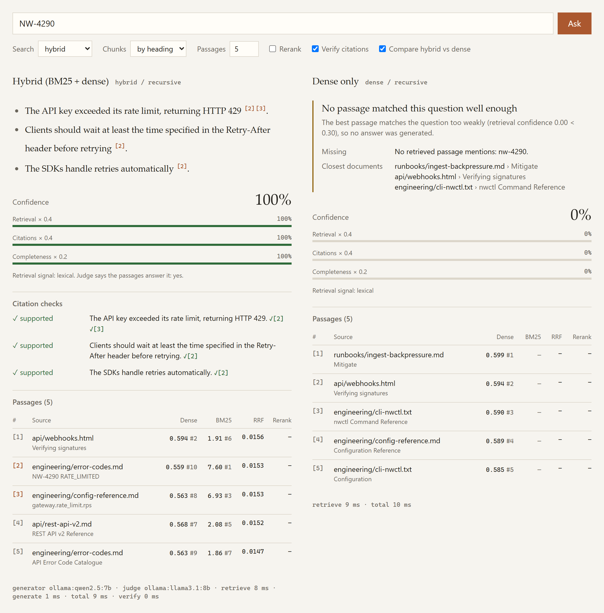
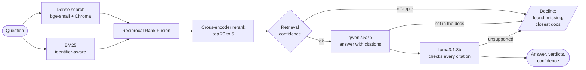
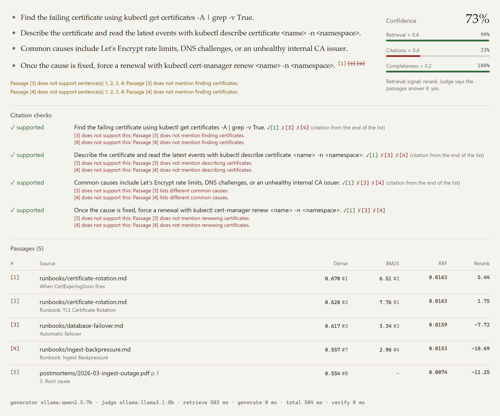
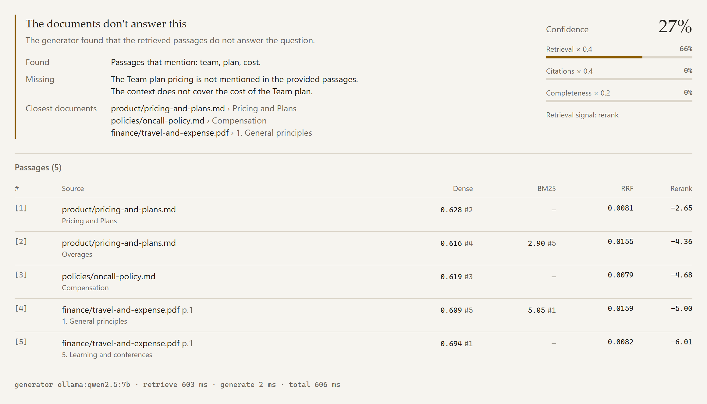
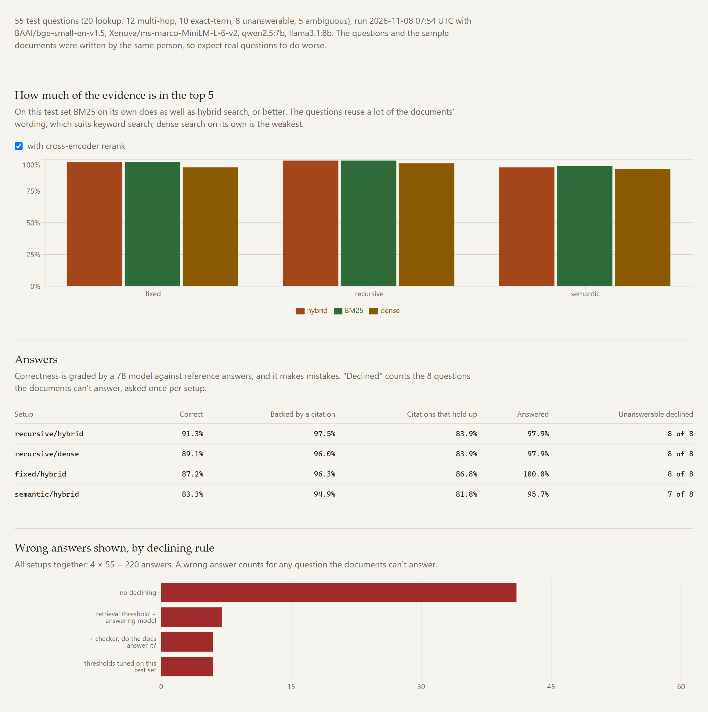

# hy-rag

A question-answering system for internal documentation. It searches with BM25 and embeddings together, reranks with a cross-encoder, answers with a citation on every sentence, and has a second model check each of those citations. When the docs don't contain the answer, it says so instead of guessing.

Everything runs locally on Ollama. No API keys, no per-query cost.

[](https://github.com/pentiumcoder/hy-rag/actions/workflows/ci.yml)


Measured on a 55-question test set with `qwen2.5:7b` and `llama3.1:8b` on a laptop GPU:

| | |
|---|---|
| Evidence found in the top 5 results | 98.9% |
| Correct answers, of the ones it gave | 91.3% |
| Answer sentences backed by the passage they cite | 97.5% |
| Unanswerable questions it declined to answer | 31 of 32 |



Same query, two retrievers. Searching for the error code `NW-4290`, hybrid search finds the right page through BM25 and answers with checked citations. Embedding search on its own ranks that page 10th, outside the top 5, so it declines to answer.

## Why I built it

Internal docs are a harder case than the usual "chat with a PDF" demo. They mix Markdown, HTML, plain text and PDF. People search for exact strings like `ingest.max_batch_size` or `NW-4012`, which embedding models handle badly. Answers are often spread over two documents. And a confident wrong answer about a runbook is worse than no answer.

So every part of this was measured against a test set before it was kept. The [case study](docs/case-study.md) goes through what changed because of those measurements.

## How it works



Documents are split into sections and chunked one of three ways (fixed size, by heading, or by topic shifts). Near-duplicate chunks are dropped. Each chunk goes into both a Chroma vector index and a BM25 index, and one class owns both so they can't drift apart.

At query time both searches run, their rankings are merged with Reciprocal Rank Fusion, and a cross-encoder reranks the top 20. The answering model has to put a `[n]` after every sentence. A second model from a different family then checks each sentence against the passage it cites, all in one call, and also says whether the passages answer the question at all.

The confidence score is `0.4 × retrieval + 0.4 × citation coverage + 0.2 × completeness`. Questions get declined at three points: when retrieval finds nothing relevant, when the answering model says the docs don't cover it, and when the checker finds the answer unsupported. The thresholds for those come from the test set, not from guesses.

## Running it

With Docker:

```bash
git clone https://github.com/pentiumcoder/hy-rag.git && cd hy-rag
docker compose up --build
```

Then open <http://localhost:8080> for the dashboard and <http://localhost:8000/docs> for the API. The first start downloads the models and indexes the sample docs (about 14 GB of disk in total), so give it a while. After that it starts in about 15 seconds.

By default it runs the small 3B models on the CPU, which takes around 45 seconds per answer. With an NVIDIA GPU, use the 7B and 8B models instead, which take about 15 seconds:

```bash
docker compose -f docker-compose.yml -f docker-compose.gpu.yml up --build
```

Without Docker, you need Python 3.11+, Node 22.22+ and Ollama:

```bash
python -m venv .venv && source .venv/bin/activate   # Windows: .venv\Scripts\activate
pip install -e ".[dev]"
hyrag ingest --all                                  # index the sample docs
ollama pull qwen2.5:7b && ollama pull llama3.1:8b
hyrag ask "How many PTO days carry over to next year?"
hyrag serve                                         # API on port 8000
npm --prefix frontend install && npm --prefix frontend run dev   # dashboard on port 5173
```

The API takes per-request options, so you can compare retrievers yourself:

```bash
curl -s localhost:8000/v1/ask -H 'Content-Type: application/json' \
  -d '{"query": "NW-4290", "overrides": {"mode": "dense", "rerank": false}}'
curl -s localhost:8000/v1/ingest -F files=@my-runbook.md
```

If you'd rather use a hosted model, set `HYRAG_LLM_PROVIDER=openai` or `anthropic`. All settings are listed in [.env.example](.env.example).

## Results

`hyrag eval` runs the 55 questions in [eval/golden.jsonl](eval/golden.jsonl): 20 simple lookups, 12 that need two documents, 10 about exact identifiers, 8 the docs can't answer and 5 deliberately vague ones. The full report is in [eval/results/report.md](eval/results/report.md).

Retrieval, as the share of each question's evidence that shows up in the top 5:

| | dense | BM25 | hybrid |
|---|---|---|---|
| recursive chunks | 84.0% | 92.5% | 92.5% |
| recursive chunks + rerank | 96.8% | 98.9% | **98.9%** |
| fixed chunks + rerank | 93.6% | 97.9% | 97.9% |
| semantic chunks + rerank | 92.5% | 94.7% | 93.6% |

Reranking helps every setup, by 3 to 13 points. Dense search alone is clearly the weakest, especially on questions that need two documents. Splitting by headings beat splitting by topic shifts on these docs.

Answers, graded against reference answers:

| setup | correct | backed by citations | citation accuracy | answered | declined correctly / caught |
|---|---|---|---|---|---|
| recursive, hybrid | **91.3%** | 97.5% | 83.9% | 97.9% | 88.9% / 100% |
| recursive, dense | 89.1% | 96.0% | 83.9% | 97.9% | 88.9% / 100% |
| fixed, hybrid | 87.2% | 96.3% | 86.8% | 100% | 100% / 100% |
| semantic, hybrid | 83.3% | 94.9% | 81.8% | 95.7% | 77.8% / 87.5% |

Deciding when to decline was the hardest part. A question like "How much does the Team plan cost?" pulls up the pricing page with a high score, but there is no Team plan. No retrieval threshold can tell that apart from a real answer, so the answering model and the checker handle those cases. Across all 220 answers in the test runs:

| declining rules | wrong answers shown |
|---|---|
| none | 41 |
| retrieval threshold + answering model | 7 |
| + checker's "do the docs answer this?" | 6 |

The test set is small, and the grading model makes mistakes too: when I went through its INCORRECT verdicts by hand, 3 of the 5 were wrong. Treat the numbers as a way to compare setups, not as exact scores.

## Screenshots

When the model cites a passage that doesn't support a sentence, the checker flags it and the citation is struck through:



A question the docs can't answer. It shows what it found, what's missing and where to look:



The evaluation tab:



## Project layout

```
src/hyrag/
  ingestion/   loaders for md, txt, html and pdf, plus the document store
  chunking/    fixed, recursive and semantic chunkers
  embeddings/  fastembed, OpenAI and a fake embedder for tests, plus a disk cache
  index/       Chroma, BM25, the tokenizer, dedup and IndexManager
  retrieval/   rank fusion, reranker and HybridRetriever
  llm/         Ollama, OpenAI and Anthropic clients, response cache, test stub
  generation/  prompts, claim parsing, citation checks, confidence, declining
  evaluation/  test set, metrics, answer grading, threshold tuning, reports
  api/         FastAPI service
  cli.py       the hyrag command
frontend/      React dashboard (Vite, TypeScript, Tailwind, Recharts)
docker/        Dockerfiles and nginx config
data/corpus/   sample docs for a made-up company, Northwind Cloud
eval/          test questions and results
scripts/       first-boot setup script, sample PDF generator
docs/          case study, demo script, roadmap, screenshots
```

## Development

```bash
ruff check . && ruff format --check . && mypy
pytest --cov                                 # offline, no models needed
HYRAG_TEST_MODELS=1 pytest -m models         # with the real embedding models
HYRAG_TEST_LLM=1 pytest -m llm               # with Ollama running
hyrag eval --offline --min-recall 0.85       # the check CI runs
npm --prefix frontend test
```

The normal test run uses a fake embedder and a simple extractive stand-in for both models, so it needs no network and no GPU. CI runs it on Python 3.11 to 3.13, along with the offline evaluation, the dashboard tests and a build of both Docker images.

## License

[MIT](LICENSE)
