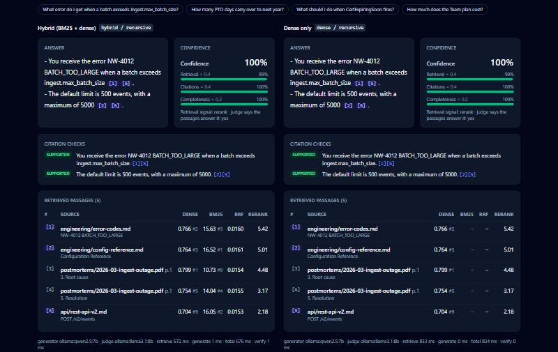
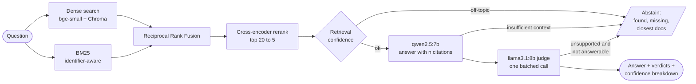
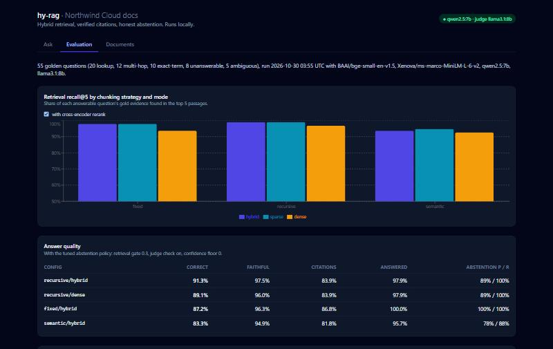

# hy-rag

**Production-style Retrieval-Augmented Generation over internal documentation**: hybrid BM25 + dense retrieval, reciprocal rank fusion, cross-encoder reranking, grounded answers with *verified* citations, and an evaluation suite that measures all of it. Runs 100% locally, with no API keys and $0 per query.

[](https://github.com/pentiumcoder/hy-rag/actions/workflows/ci.yml)


| On a 55-question golden set, with local 7–8B models | |
|---|---|
| Gold evidence retrieved in the top 5 (hybrid + rerank) | **98.9%** |
| Answers correct, of those given | **91.3%** |
| Answer sentences supported by the passages they cite | **97.5%** |
| Unanswerable questions refused instead of guessed | **31 of 32** |
| Cost per query | **$0** (Ollama on an 8 GB laptop GPU) |



*Hybrid vs dense-only on the same question: every `[n]` jumps to its passage, each sentence shows the judge's verdict, and the passage table shows every stage's score.*

## Why this exists

Most RAG demos embed one PDF and call it done. Real internal docs are messier:

- **Mixed formats.** Markdown wikis, HTML exports, plain-text runbooks and PDF postmortems.
- **Exact identifiers.** Questions mention config keys (`ingest.max_batch_size`), error codes (`NW-4012`) and CLI flags that pure semantic search often misses.
- **Facts spread across documents.** "What error does a Starter customer get at their rate limit, and what is that limit?" needs the pricing page *and* the error catalogue.
- **High cost of being wrong.** A confident, uncited answer is worse than "I don't know".

hy-rag treats those as engineering problems and measures every design decision against a golden evaluation set. The [case study](docs/case-study.md) walks through what was tried, what the numbers said and what changed because of them.

## How it works



1. **Ingest:** Markdown, text, HTML and PDF are normalized into sections. Three chunking strategies are available (fixed, header-aware recursive, semantic). Near-duplicates are dropped, and chunks go into Chroma and BM25 through one index manager, which keeps the two in sync.
2. **Retrieve:** dense and BM25 run side by side, are fused with Reciprocal Rank Fusion, and are reranked by a cross-encoder. Every result keeps every stage's score.
3. **Answer:** the generator must cite a passage after every sentence. A judge from a *different model family* checks every (sentence, passage) pair in one call and also rates whether the passages answer the question at all.
4. **Decide:** confidence is `0.4 × retrieval + 0.4 × citation coverage + 0.2 × completeness`. Abstention is layered: a retrieval gate, the generator's own refusal, and the judge's check. Its thresholds were tuned by replaying recorded eval runs.

## Quickstart

### Docker (dashboard, API and Ollama)

```bash
git clone https://github.com/pentiumcoder/hy-rag.git && cd hy-rag
docker compose up --build                                   # CPU: qwen2.5:3b + llama3.2:3b
docker compose -f docker-compose.yml -f docker-compose.gpu.yml up --build   # NVIDIA GPU: 7b + 8b
```

Open the dashboard at <http://localhost:8080> and the API docs at <http://localhost:8000/docs>.

- **First start:** it downloads the Ollama image and the models, about 14 GB on disk with the CPU models, and indexes the corpus.
- **Later starts:** restarts take about 15 s, because nothing is re-embedded or re-pulled.
- **Speed:** on a laptop CPU an answer takes about 45 s with the 3b models; the GPU file brings that to about 15 s with the evaluated 7b/8b models.

### Local development

```bash
python -m venv .venv && source .venv/bin/activate   # Windows: .venv\Scripts\activate
pip install -e ".[dev]"
hyrag ingest --all                                  # parse, chunk, dedup, embed and index
hyrag search "NW-4290" --mode sparse                # retrieval only, every stage's score

ollama pull qwen2.5:7b && ollama pull llama3.1:8b   # generator and judge, about 9.6 GB
hyrag ask "How many PTO days carry over to next year?"
hyrag serve                                         # API on http://127.0.0.1:8000
npm --prefix frontend install && npm --prefix frontend run dev   # dashboard on :5173
hyrag eval                                          # the full evaluation, ~1 h on an 8 GB GPU
```

```bash
curl -s localhost:8000/v1/ask -H 'Content-Type: application/json' \
  -d '{"query": "NW-4290", "overrides": {"mode": "dense", "rerank": false}}'
curl -s localhost:8000/v1/ingest -F files=@my-runbook.md
```

To use a hosted model instead, set `HYRAG_LLM_PROVIDER=openai` or `anthropic` and install the matching extra. Every setting is documented in [.env.example](.env.example).

## Evaluation results

All numbers come from `hyrag eval` on the 55-question [golden set](eval/golden.jsonl): 20 lookup, 12 multi-hop, 10 exact-term, 8 unanswerable and 5 ambiguous questions. Full report: [eval/results/report.md](eval/results/report.md).

**Retrieval** (recall@5 = share of a question's gold evidence in the top 5 chunks, over the 47 answerable questions):

| | dense | sparse (BM25) | hybrid (RRF) |
|---|---|---|---|
| recursive chunks | 84.0% | 92.5% | 92.5% |
| recursive + cross-encoder rerank | 96.8% | 98.9% | **98.9%** |
| fixed + rerank | 93.6% | 97.9% | 97.9% |
| semantic + rerank | 92.5% | 94.7% | 93.6% |

- The reranker adds 3 to 13 points to every configuration.
- Dense search alone misses the most, especially on multi-hop questions: 67 to 71% before reranking.
- Header-aware recursive chunks beat embedding-based semantic chunks on this corpus.

**Answers** (`qwen2.5:7b` answering, `llama3.1:8b` checking citations and grading against the reference answers):

| config | correct (of answered) | faithfulness | citation accuracy | answered | abstention precision / recall |
|---|---|---|---|---|---|
| **recursive / hybrid** | **91.3%** | 97.5% | 83.9% | 97.9% | 88.9% / 100% |
| recursive / dense | 89.1% | 96.0% | 83.9% | 97.9% | 88.9% / 100% |
| fixed / hybrid | 87.2% | 96.3% | 86.8% | 100% | 100% / 100% |
| semantic / hybrid | 83.3% | 94.9% | 81.8% | 95.7% | 77.8% / 87.5% |

**Abstention:** no retrieval score separates a near-miss ("How much does the Team plan cost?", when there is no Team plan) from a real answer. So off-topic questions are refused before generation, and near-misses are left to the generator and the judge.

| abstention policy | answered wrongly (of 220) | utility |
|---|---|---|
| none | 41 | +0.36 |
| retrieval gate + generator | 7 | +0.67 |
| tuned: + judge answerability check | **6** | **+0.68** |

These are small-sample numbers: 55 questions, graded by a 7B judge that got 3 of its 5 INCORRECT verdicts wrong when checked by hand. Read them as comparisons between configurations rather than as absolute scores.

## Why hybrid: a real example

Searching for the error code `NW-4290`:

| | where the `NW-4290` catalogue entry ranks |
|---|---|
| dense only (`bge-small`) | **#10**; the top 10 similarities all sit between 0.56 and 0.60, so the model is guessing |
| BM25 only | **#1** |
| hybrid (RRF) | #2 |
| hybrid + cross-encoder | **#1**, followed by the SDK's retry guidance for that error, which only BM25 found |

```text
$ hyrag search "NW-4290" -k 3
| # | source                          | section                |     dense |    bm25 |    rrf | rerank |
|---+---------------------------------+------------------------+-----------+---------+--------+--------|
| 1 | engineering/error-codes.md      | NW-4290 RATE_LIMITED   | 0.559 #10 | 7.60 #1 | 0.0153 |   6.34 |
| 2 | api/sdk-python.md               | Retries                |         - | 7.14 #2 | 0.0081 |   5.87 |
| 3 | engineering/config-reference.md | gateway.rate_limit.rps |  0.563 #8 | 6.93 #3 | 0.0153 |   5.32 |
```

## Answers that show their work

When the model cites the wrong passage, the judge says so:

```text
$ hyrag ask "What should I do when CertExpiringSoon fires?"
 - Find the failing certificate using kubectl get certificates -A | grep -v True.
 - Describe the certificate and read the latest events with kubectl describe ...
 - Common causes include Let's Encrypt rate limits, DNS challenges, or an unhealthy internal CA issuer.
 - Once the cause is fixed, force a renewal with kubectl cert-manager renew <name> -n <namespace>. [1][3][4]

[1] runbooks/certificate-rotation.md > When CertExpiringSoon fires
[3] runbooks/database-failover.md > Automatic failover  flagged
[4] runbooks/ingest-backpressure.md > Runbook: Ingest Backpressure  flagged

confidence 0.85 = 0.4 x retrieval 0.99 (rerank) + 0.4 x citations 0.88 + 0.2 x completeness 0.50
! Passage [3] does not support sentence(s) 1, 2, 3, 4: Passage [3] is about a different alert ...
```

## The dashboard

| Tab | What it shows |
|---|---|
| **Ask** | The answer with clickable `[n]` citations that scroll to and highlight the passage; per-sentence verdicts; confidence breakdown bars; the ranked passages with dense, BM25, RRF and rerank scores. **Compare hybrid vs dense** runs both side by side, and the rerank toggle shows the raw retrievers. |
| **Evaluation** | Recall@5 by chunking strategy and mode, answer quality per configuration, and what each abstention layer adds. |
| **Documents** | Every indexed document, plus drag-and-drop upload: files are chunked, deduplicated, embedded and indexed for every strategy. |



## Project layout

```
src/hyrag/
  ingestion/   loaders (md, txt, html, pdf), normalization, raw/processed store
  chunking/    fixed, recursive, semantic chunkers behind one Chunker protocol
  embeddings/  fastembed, OpenAI (optional) and fake embedders, plus the disk cache
  index/       Chroma vector store, BM25 store, tokenizer, dedup, IndexManager
  retrieval/   reciprocal rank fusion, cross-encoder reranker, HybridRetriever
  llm/         Ollama, OpenAI and Anthropic chat clients, response cache, test stub
  generation/  prompts, claim parsing, citation verifier, confidence, abstention, AnswerPipeline
  evaluation/  golden set, metrics, correctness judge, abstention policy tuning, reports
  api/         FastAPI service
  cli.py       `hyrag` command-line interface
frontend/      React + Vite + TypeScript dashboard (Tailwind, Recharts, Vitest)
docker/        API and dashboard images, nginx config
data/corpus/   Northwind Cloud sample documentation (26 docs, 4 formats)
eval/          golden questions and committed results (report, charts, per-question runs)
scripts/       first-boot seed script, sample-PDF generator
docs/          case study, demo script, roadmap, architecture decision records
```

## Development

```bash
ruff check . && ruff format --check . && mypy
pytest --cov                                 # offline: fake embedder, stub LLM, no reranker
HYRAG_TEST_MODELS=1 pytest -m models         # retrieval with the real local models
HYRAG_TEST_LLM=1 pytest -m llm               # answering end to end, needs Ollama running
hyrag eval --offline --min-recall 0.85       # what CI runs on every pull request
npm --prefix frontend test                   # dashboard tests (Vitest + Testing Library)
```

CI runs the Python checks on 3.11, 3.12 and 3.13, the offline evaluation, the dashboard's type check, tests and build, and a build of both Docker images. The default test run uses a deterministic fake embedder and an extractive stub model that plays both generator and judge, so the whole pipeline runs with no network, models or API keys.

## Design decisions

- [ADR-0001: Three switchable chunking strategies](docs/adr/0001-chunking-strategies.md)
- [ADR-0002: Hybrid retrieval with equal-weight RRF and a cross-encoder rerank](docs/adr/0002-hybrid-retrieval-and-rrf.md)
- [ADR-0003: Batched cross-family citation checks, confidence and abstention](docs/adr/0003-verified-citations-confidence-abstention.md)
- [ADR-0004: A layered abstention policy, tuned on the evaluation set](docs/adr/0004-tuned-abstention-policy.md)
- [ADR-0005: Deployment: one API process owns the indexes; small models on CPU by default](docs/adr/0005-deployment.md)

## License

[MIT](LICENSE)
