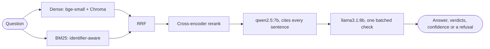

# Case study: checked answers over internal docs, on a laptop

In short: on a 55-question test set, 97.5% of answer sentences are backed by the passage they cite, 83.9% of individual citations hold up, and all 8 questions the docs can't answer are declined. It runs on 7B and 8B models on an 8 GB laptop GPU, so there's no per-query cost.

One caveat up front: I wrote the test questions and the documents, so the questions use the documents' own wording. Treat these as best-case numbers.

## The problem

Most retrieval demos index one clean PDF. Internal documentation is messier. It comes as Markdown, HTML exports, plain-text runbooks and PDF postmortems. People search for exact strings like `ingest.max_batch_size` or `NW-4290`. Answers are often split across two documents. And if someone follows a wrong runbook step because the system sounded sure of itself, that's worse than being told the docs don't say.

I wanted a system that answers only from the documents, shows where each sentence came from, checks that, and declines when it should, without any API keys.

The test corpus is 26 documents for a made-up cloud company, Northwind Cloud: runbooks, config and API references, policies, a glossary and two postmortems. The test set has 55 questions: 20 simple lookups, 12 that need two documents, 10 about exact identifiers, 8 the docs can't answer, and 5 that are deliberately vague.

## What the measurements changed

### Rank fusion weights

I started by weighting dense search 0.7 and BM25 0.3 when merging the two rankings with Reciprocal Rank Fusion. The arithmetic says that can't work. With the usual constant of 60, rank 1 and rank 10 score only about 15% apart, so at 0.7/0.3 a page that only BM25 ranks first would land behind the first 82 dense results. The "hybrid" search would really be dense search.

That matters on real queries. For `NW-4290`, dense search ranks the page that defines the error 10th, with its top ten similarity scores all between 0.56 and 0.60, which is close to random. BM25 ranks it first. I switched to equal weights, and with reranking that page now comes first.

I also replaced the BM25 scoring in `rank_bm25`. Its idf gives zero weight to any word that appears in half the chunks, which threw away useful words on a corpus this small. Lucene's version is always positive.

Result: 84.0% recall@5 for dense search alone, 98.9% for hybrid with reranking.

The less flattering part: BM25 on its own also gets 98.9%, and with semantic chunks it beats hybrid slightly (94.7% against 93.6%). On my test set the dense half adds nothing measurable, because the questions repeat the documents' words and keyword search is good at that. Whether dense search earns its place on paraphrased questions I haven't tested.

### Citations that point at the wrong passage

Asked how many PTO days carry over, `qwen2.5:7b` gave the right answer, "up to 5", but cited a passage about taking time off during an on-call week. Anyone who clicked that citation would be misled even though the answer was right.

So a second model, `llama3.1:8b`, checks every sentence against the passage it cites. It's from a different model family on purpose, because a model checking its own output tends to go easy on itself. All the checks for one answer go in a single call: on an 8 GB GPU the two models take turns in memory, and one call per citation would have been far too slow.

Two prompt fixes mattered as well. Labelling passages `<passage id="n">` instead of `[n] Source:` stopped the 7B model from confusing passage headers with its own citations. And a worked example in the prompt got copied into an unrelated answer ("Unused PTO expires on March 31", cited to a certificate runbook), so I replaced it with a placeholder template.

Result: 97.5% of answer sentences are backed by the passage they cite, and the dashboard strikes through the citations that aren't.

The checks also feed the confidence score. At first, a sentence counted as covered if its best citation held up, so an answer with a wrong extra citation could still show 100%. Now every checked citation counts, and one wrong citation out of two halves that sentence's share.

### Deciding when to decline

My first version declined when the reranker's best score was low. The test set showed why that can't work on its own:

| questions | retrieval confidence |
|---|---|
| off-topic ("Who won the 2022 World Cup?") | 0.03 |
| near misses ("How much does the Team plan cost?", when there is no Team plan) | 0.22 to 0.91 |
| answerable | 0.62 and up |

The near misses overlap the real questions almost completely. So declining now happens at three points. A retrieval threshold catches only the clearly off-topic questions. The answering model is told to reply `INSUFFICIENT_CONTEXT` when the passages don't cover the question. And the checking model, in the same call it already makes, says whether the passages answer the question at all.

To set the thresholds, the evaluation records every signal with all three rules turned off, then replays every combination of thresholds. A correct answer counts +1 and a wrong one −2, since a wrong answer that looks right does more harm than an honest "I don't know". Wrong answers shown went from 41 with no rules, to 7 with the first two rules, to 6 with all three. I also tried a minimum confidence score, but it removed correct answers as fast as wrong ones, so it's off.

### A Chroma bug

The offline evaluation in CI started failing now and then with "Nothing found on disk" from Chroma. A stress test reproduced it in plain Chroma, without any of my code, about once in 50 freshly built indexes. Retrying, changing flush settings and cleaning up temp directories made no difference. What did turn out to be reliable is that the stored text stays readable when the vectors don't. So when it happens, the query falls back to an exact search over the re-embedded text, which comes out of the embedding cache almost for free. Over 240 test builds that took the failures from several per run to none.

## Architecture



Embeddings and reranking run on the CPU through fastembed. Answering and checking run on Ollama. Storage is Chroma embedded in the API process plus a JSON BM25 index. A FastAPI service and a React dashboard sit on top, and Docker Compose runs the whole thing: small 3B models on the CPU by default, and the 7B and 8B models from the evaluation with a GPU override file.

## Results

| | |
|---|---|
| recall@5 (recursive chunks, hybrid, rerank) | 98.9% |
| correct answers, of those given | 91.3% |
| sentences backed by their citation | 97.5% |
| citation accuracy | 83.9% |
| unanswerable questions declined | 8 of 8 (31 of 32 over all four setups) |
| time per answer on an 8 GB GPU | about 15 s, of which about 11 s is the checking step |

## What I'd do next

The judge's value on near misses rests on very few cases, and there are only 6 distinct near-miss questions. That's the first thing I'd add more of.

The grading model is noisy. Going through its INCORRECT verdicts by hand, 3 of 5 were wrong. A few dozen human labels would make the correctness number something I could actually rely on.

Checking takes most of the time, because the two models swap in and out of an 8 GB GPU. A smaller checking model, or a GPU that fits both, would roughly halve the response time.

One near miss still gets through. With semantic chunking, the answering model said the Team plan is the Growth plan at $499, and the checker accepted it.

## Reproducing it

```bash
docker compose up --build    # dashboard on http://localhost:8080
hyrag eval --offline         # the evaluation with stand-in models, about 20 s
hyrag eval                   # with the real models, about an hour on an 8 GB GPU
```
