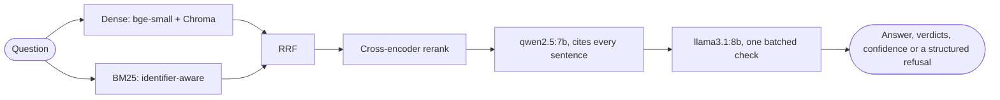

# Case study: verified answers over internal docs, on a laptop, for $0 per query

> **97.5% faithfulness and 83.9% citation accuracy on a 55-question eval, with 31 of 32 unanswerable questions refused. It runs on local 7–8B models on an 8 GB laptop GPU, at $0 per query.**

## The problem

Internal documentation is where RAG demos stop working:

- **The formats are mixed:** Markdown wikis, HTML exports, plain-text runbooks and PDF postmortems.
- **The questions are full of identifiers:** `ingest.max_batch_size`, `NW-4290`, `X-NW-Signature`.
- **Facts are spread across documents.**
- **A wrong answer is costly.** An engineer who follows a confidently wrong runbook step is worse off than one who was told "the docs don't say".

The goal was a system that answers from the documents, shows exactly where every sentence came from, checks that, and refuses when it should, all without API keys.

The corpus is 26 internal documents for a fictional cloud company, Northwind Cloud: runbooks, config and API references, policies, a glossary and two postmortems. The golden set is 55 questions: 20 lookup, 12 multi-hop, 10 exact-term, 8 unanswerable and 5 deliberately ambiguous.

## What the measurements changed

Each of these started as a plan, met a number, and changed.

### 1. Hybrid retrieval was nearly turned into dense-only by its own weights

The plan fused dense and BM25 results with Reciprocal Rank Fusion, weighted 0.7 / 0.3.

- **The arithmetic says that doesn't work.** With the standard `k = 60`, rank 1 and rank 10 score only about 15% apart. At 0.7 / 0.3, a document that only BM25 ranks first would land below the first 82 dense results. "Hybrid" would have been dense search with extra steps.
- **The real query shows why it matters.** For `NW-4290`, dense search alone ranks the error's catalogue entry 10th, with its top 10 similarities all between 0.56 and 0.60, so it was guessing. BM25 ranks it first.
- **What changed:** equal weights. Hybrid with reranking now puts it first ([ADR-0002](adr/0002-hybrid-retrieval-and-rrf.md)).

A second issue: the standard `rank_bm25` idf gives zero weight to any term that appears in half the chunks, which erased useful words on a small corpus. It was replaced with Lucene's always-positive idf.

**Result:**

| setup | recall@5 |
|---|---|
| dense only | 84.0% |
| hybrid + cross-encoder rerank | 98.9% |

### 2. The model cited the wrong passage, and only a checker could tell

Asked how many PTO days carry over, `qwen2.5:7b` answered correctly ("up to 5") but cited a passage about taking PTO during an on-call week. A reader who clicks that citation is misled, even though the answer is right.

- **A judge checks every citation.** Every (sentence, cited passage) pair now goes to a judge from a different model family, `llama3.1:8b`. Same-model self-checks are known to be lenient, so the judge comes from a different family.
- **All checks go in one call.** On 8 GB of VRAM the two models swap on every call, so one batched JSON call per answer replaced one call per pair.
- **The prompt layout was fixed.** Labelling passages `<passage id="n">` instead of `[n] Source:` stopped the 7B model from confusing passage headers with its own citations.
- **The example was replaced with placeholders.** A worked example in the prompt leaked into an unrelated answer ("Unused PTO expires on March 31", cited to a certificate runbook), so it became `<step, taken from passage 2> [2]` ([ADR-0003](adr/0003-verified-citations-confidence-abstention.md)).

**Result:** 97.5% of answer sentences are supported by the passages they cite. The dashboard flags the rest in red.

### 3. "When should it refuse?" had to be measured, not guessed

The first design refused when the cross-encoder's best score was low. The eval showed why that can't work on its own:

| questions | retrieval confidence |
|---|---|
| off-topic ("Who won the 2022 World Cup?") | 0.03 |
| near-misses ("How much does the Team plan cost?", when there is no Team plan) | 0.22 to 0.91 |
| answerable | from 0.62 |

**The fix is layered:**
- A retrieval gate catches only the off-topic questions.
- The generator is told to reply `INSUFFICIENT_CONTEXT`.
- The judge, in the same verification call, rates whether the passages answer the question at all, and withdraws unsupported answers.

**The thresholds were tuned, not guessed.** The eval records every signal with all rules switched off, then replays every policy on a grid. A correct answer scores +1 and a wrong one −2, because a wrong answer shown as right costs more than an honest refusal ([ADR-0004](adr/0004-tuned-abstention-policy.md)).

| policy | wrong answers shown (of 220) |
|---|---|
| no abstention | 41 |
| gate + generator | 7 |
| tuned | 6 |

**A minimum-confidence rule was tested and rejected:** it withdrew correct answers as fast as wrong ones.

### 4. A database bug found by the evaluation, not by users

Running the evaluation's offline mode in CI surfaced an intermittent failure: Chroma 1.x reporting "Nothing found on disk" for a freshly built collection.

- **Reproduced outside the project.** A stress test reproduced it in plain Chroma, about once in 50 index builds.
- **Ruled out the guesses.** It showed that retries, flush settings and temp-directory cleanup were not the cause.
- **Found what still worked.** The collection's vectors become unreadable, but its texts do not.
- **The fix:** queries fall back to exact search over the re-embedded texts, using the embedding cache. Across 240 stress-test builds the failure rate went from several per run to none.

## Architecture



- **Everything local:**
  - embeddings and reranking with fastembed (ONNX on CPU)
  - generation and judging with Ollama
  - storage in embedded Chroma plus a JSON BM25 index
- **A FastAPI service:** ask with per-request overrides, retrieval-only search, documents, upload and eval summary.
- **A React dashboard:** clickable citations, side-by-side hybrid vs dense, eval charts and upload.
- **Docker Compose:** CPU by default with 3b models, plus a GPU file for the evaluated 7–8B models.

## Results

| | |
|---|---|
| recall@5 (recursive chunks, hybrid, rerank) | 98.9% |
| correct, of answered (recursive, hybrid) | 91.3% |
| faithfulness / citation accuracy | 97.5% / 83.9% |
| unanswerable questions refused | 31 of 32 |
| latency (8 GB GPU) | about 15 s; verification is about 11 s of that, mostly the model swap |
| cost | $0 per query |

## What I would do next

- **Grow the near-miss part of the golden set.** The judge check's value rests on one case, and 6 distinct near-misses is a small sample.
- **Calibrate the judge.** By hand, 3 of its 5 INCORRECT verdicts were wrong. A few dozen human labels would turn correctness into a measured number rather than a lower bound.
- **Reduce verification latency.** Two models on 8 GB of VRAM means a swap per answer. A smaller judge, or a GPU with room for both, would roughly halve the latency.
- **Fix the remaining miss.** One near-miss still gets through every layer: semantic chunking let the generator claim "the Team plan is the Growth plan" and the judge accepted it.

## Reproduce it

```bash
docker compose up --build              # http://localhost:8080
hyrag eval --offline                   # the whole eval with fake models, ~20 s
hyrag eval                             # with the local models, ~1 h on an 8 GB GPU
```
