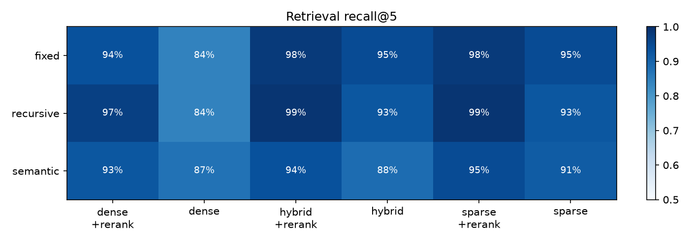
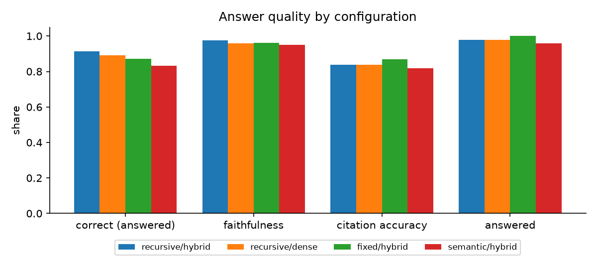
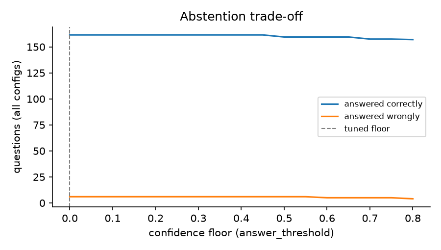

# Evaluation report

Generated 2026-10-30 03:55 UTC in **local models** mode from `eval/golden.jsonl` (55 questions: 20 lookup, 12 multi-hop, 10 exact-term, 8 unanswerable, 5 ambiguous).

Models: embedder `BAAI/bge-small-en-v1.5`, reranker `Xenova/ms-marco-MiniLM-L-6-v2`, generator `qwen2.5:7b`, judge `llama3.1:8b`.

## Retrieval

Recall@k is the share of a question's gold evidence found in the top k chunks; MRR is the mean reciprocal rank of the first relevant chunk. Answerable questions only.

| config | recall@1 | recall@5 | MRR | lookup | multi-hop | exact-term | ambiguous |
|---|---|---|---|---|---|---|---|
| recursive/hybrid+rerank | 68.1% | **98.9%** | 0.876 | 100.0% | 95.8% | 100.0% | 100.0% |
| recursive/sparse+rerank | 68.1% | **98.9%** | 0.876 | 100.0% | 95.8% | 100.0% | 100.0% |
| fixed/sparse+rerank | 71.3% | **97.9%** | 0.879 | 100.0% | 91.7% | 100.0% | 100.0% |
| fixed/hybrid+rerank | 70.2% | **97.9%** | 0.869 | 100.0% | 91.7% | 100.0% | 100.0% |
| recursive/dense+rerank | 68.1% | **96.8%** | 0.869 | 95.0% | 95.8% | 100.0% | 100.0% |
| fixed/sparse | 67.0% | **94.7%** | 0.857 | 100.0% | 87.5% | 100.0% | 80.0% |
| semantic/sparse+rerank | 64.9% | **94.7%** | 0.824 | 100.0% | 95.8% | 100.0% | 60.0% |
| fixed/hybrid | 64.9% | **94.7%** | 0.817 | 100.0% | 87.5% | 100.0% | 80.0% |
| fixed/dense+rerank | 68.1% | **93.6%** | 0.837 | 95.0% | 91.7% | 90.0% | 100.0% |
| semantic/hybrid+rerank | 64.9% | **93.6%** | 0.820 | 100.0% | 95.8% | 90.0% | 70.0% |
| recursive/sparse | 64.9% | **92.5%** | 0.838 | 95.0% | 83.3% | 100.0% | 90.0% |
| semantic/dense+rerank | 64.9% | **92.5%** | 0.822 | 100.0% | 95.8% | 90.0% | 60.0% |
| recursive/hybrid | 63.8% | **92.5%** | 0.813 | 95.0% | 79.2% | 100.0% | 100.0% |
| semantic/sparse | 61.7% | **91.5%** | 0.782 | 100.0% | 91.7% | 90.0% | 60.0% |
| semantic/hybrid | 61.7% | **88.3%** | 0.779 | 95.0% | 91.7% | 90.0% | 50.0% |
| semantic/dense | 55.3% | **87.2%** | 0.751 | 95.0% | 87.5% | 90.0% | 50.0% |
| fixed/dense | 63.8% | **84.0%** | 0.801 | 95.0% | 66.7% | 90.0% | 70.0% |
| recursive/dense | 60.6% | **84.0%** | 0.782 | 95.0% | 70.8% | 90.0% | 60.0% |

## Answers

With the tuned abstention policy (retrieval gate 0.3, judge check on, confidence floor 0.0). Correctness is graded by `llama3.1:8b` against the reference answers. Latency counts only calls that reached the model; replies served from the LLM cache show as cached.

| config | answered | correct (answered) | correct (all answerable) | faithfulness | citation accuracy | abstention P / R | median latency |
|---|---|---|---|---|---|---|---|
| recursive/hybrid | 97.9% | **91.3%** | 89.4% | 97.5% | 83.9% | 88.9% / 100.0% | cached |
| recursive/dense | 97.9% | **89.1%** | 87.2% | 96.0% | 83.9% | 88.9% / 100.0% | cached |
| fixed/hybrid | 100.0% | **87.2%** | 87.2% | 96.3% | 86.8% | 100.0% / 100.0% | cached |
| semantic/hybrid | 95.7% | **83.3%** | 79.8% | 94.9% | 81.8% | 77.8% / 87.5% | cached |

## Abstention

How well each signal separates answerable from unanswerable questions (AUROC, 1.0 is perfect, 0.5 is chance), pooled over all configurations:

| signal | AUROC |
|---|---|
| retrieval confidence | 0.967 |
| generator answered | 0.958 |
| judge answerability | 0.742 |
| final confidence | 0.985 |

What each layer adds, pooled over all configurations. Utility counts a correct answer as +1 and a wrong one (including any answer to an unanswerable question) as -2, per question.

| policy | abstention P / R | answered correctly | answered wrongly | utility |
|---|---|---|---|---|
| no abstention (generator rule ignored) | never abstains | 161.5 | 41.0 | +0.361 |
| Day 3: retrieval gate 0.2 + generator | 88.2% / 93.8% | 161.5 | 7.0 | +0.670 |
| + judge answerability check | 88.6% / 96.9% | 161.5 | 6.0 | +0.680 |
| tuned | 88.6% / 96.9% | 161.5 | 6.0 | +0.680 |

## Charts

